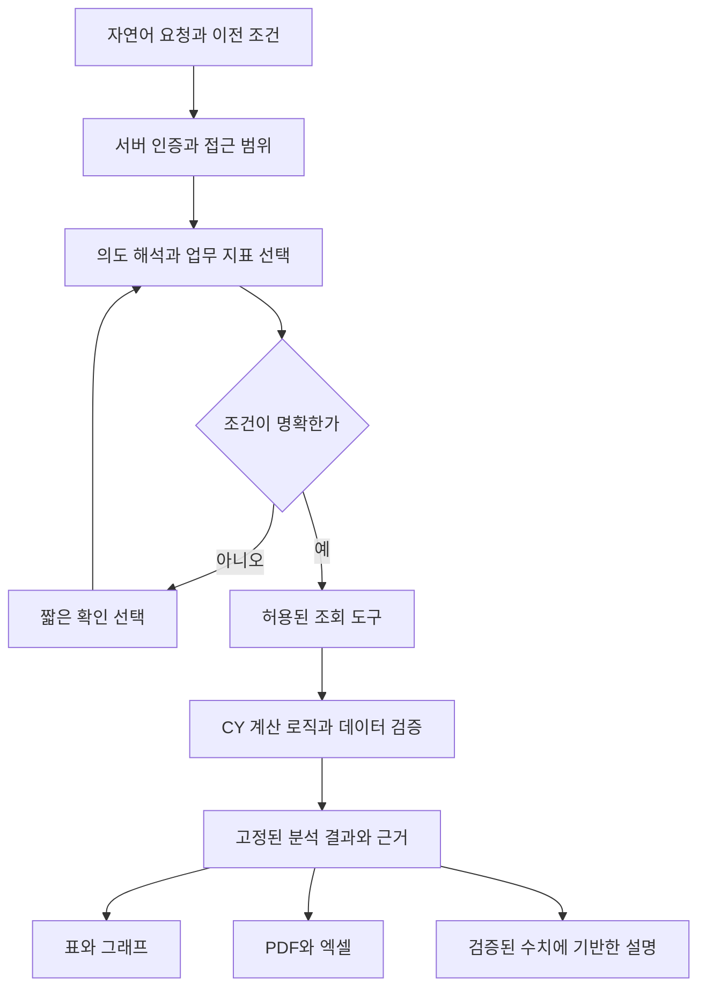

# CY AI 업무 도우미 고도화 기획안

- 작성일: 2026-09-28
- 상태: candidate — 코드 조사에 근거한 개발 제안. 운영 검증 또는 구현 완료를 뜻하지 않는다.
- 목표: 자연어로 업무 데이터를 찾고, 비교·분석하고, 같은 결과를 PDF·엑셀로 제작하는 작업 공간을 만든다.
- 최초 적용: 일보·인력·팀·현장. 이후 정산·카드·숙소·차량·자재로 확장한다.
- 산출물 범위: 제품 기획, 설계 방향, 개발 백로그, 검증 기준. 운영 데이터 변경·API 호출·배포는 이번 기획에 포함하지 않는다.

후속 구현: 일보·인력 범위의 대화→집계→PDF·엑셀 흐름과 합성 자료 검증은 [1차 구현 기록](./cy-ai-workspace-implementation.md)에 정리했다. 전체 기획의 완료 또는 운영 출시를 뜻하지 않으며, 실제 모델 평가·일반 화면 대조·업무 확장은 남아 있다.

추가 진행: 실제 Gemini 평가와 확정 정산·차감 비용 확장 결과는 [2차 구현 기록](./cy-ai-workspace-phase2.md)에 정리했다. 원장 대사·저장 분석·정기 보고는 후속 범위다.

최신 진행: [3차 구현 기록](./cy-ai-workspace-phase3.md)에 확정 정산에 연결된 카드·숙소·차량 청구서 대사를 정리했다. 일보·지원비 및 미연결 청구서 전체 대사와 저장 분석·정기 보고는 남아 있다.

추가 구현: [4차 구현 기록](./cy-ai-workspace-phase4.md)에 조회 조건·보고서 구성 저장과 현재 권한·최신 데이터 재실행을 정리했다. 미연결 청구서와 일보·지원비 대사, 정기 보고는 후속 범위다.

5차 진행: [미연결 청구서 점검 기록](./cy-ai-workspace-phase5.md)에 현재 확정 카드·숙소·차량 청구서의 정산 ID 연결, 미연결 후보·보류·정산 확인 불가 분류 및 보고서 출력을 정리했다. 일보·지원비 대사와 정기 보고는 후속 범위다.

6차 진행: [일보·지원비 저장 근거 점검 기록](./cy-ai-workspace-phase6.md)에 지원비 상세와 확정 정산의 연결·공수·금액 비교 및 일보 금액 근거 부족 표시를 정리했다. 현재 원장 전체 대사, 과거 일보 금액 복원, 자연어 저장 관리·정기 보고는 후속 범위다.

7차 진행: [저장한 분석의 자연어 검색·실행](./cy-ai-workspace-phase7.md)을 구현했다. 후보 선택·이전 선택 참조·권한 및 항목 버전 재검사를 포함한다. 저장·덮어쓰기·삭제는 기존 화면에서 수행한다.

8차 진행: [정기 보고 설정·실행·보관](./cy-ai-workspace-phase8.md)을 구현했다. 한국 시간의 반복 일정, 비공개 결과 7일 보관, 권한·저장 조건 변경 시 중지, 실패 기록과 제한된 재시도를 포함한다. 예약은 화면에서 내용을 확인해 저장하며 자연어 요청은 이 화면을 안내한다.

9차 진행: [통합 검증·운영 전환 준비](./cy-ai-workspace-phase9.md)에 서버 전체 중지·지정 계정 시범 운영·자동 보고 중지 설정, 출시 검사, 운영 읽기 전용 점검과 적용·복구 절차를 정리했다. 최종 로컬 검사 8개 단계는 모두 통과했으며, 실제 운영 배포와 로그인 계정의 전 과정 검증은 별도 남은 조건이다.

9차 후속: 사용자의 다음 단계 요청에 따라 [운영 반영](./cy-ai-workspace-deployment.md)을 완료했다. 최신 운영 Gemini 개선을 보존한 버전으로 서버 3개·인덱스 11개·화면이 반영됐고, 운영 브라우저에서 중지 정책도 확인했다. 기능은 중지 상태이며 시범 계정 활성화와 실제 업무 원본 대조는 별도 인수 조건으로 유지한다.

현재 구현 범위는 아래의 총 9차 작업 묶음으로 정리한다. 최초 설계의 단계 번호와 구분하는 구현 기록이며, 별도 확장 요청에 따라 이후 범위가 추가될 수 있다.

| 차수 | 범위 | 현재 상태 |
|---|---|---|
| 1 | 일보·인력 자연어 조회와 PDF·엑셀 | 로컬 구현·검증 완료 |
| 2 | 실제 Gemini 평가와 확정 정산 분석 | 로컬 구현·검증 완료 |
| 3 | 정산 연결 청구서 금액 대사 | 로컬 구현·검증 완료 |
| 4 | 분석 조건 저장·재실행 | 로컬 구현·검증 완료 |
| 5 | 정산 미연결 청구서 후보 점검 | 로컬 구현·검증 완료 |
| 6 | 일보·지원비 저장 근거 점검 | 로컬 구현·검증 완료 |
| 7 | 저장한 분석의 자연어 검색·실행 | 로컬 구현·검증 완료 |
| 8 | 정기 보고 설정·실행·보관·실패 처리 | 로컬 구현·검증 완료 |
| 9 | 통합 검증·실제 계정·운영 설정·출시 준비 | 운영 배포 및 중지 상태 검증 완료, 시범 계정·실제 자료 전 과정 검증 대기 |

과거 일보 금액 복원·전체 원장 대사와 외부 발송은 별도 확장 범위다. 로컬 구현·검증은 운영 배포나 전체 기획 완료를 뜻하지 않는다.

## 1. 만들 제품과 핵심 사용 장면

사용자가 “지난달 현장별 공수와 노무비를 비교해서 보고서로 만들어줘”라고 입력하면, 기간과 집계 기준이 표시된 결과를 받고 같은 대화에서 대상을 좁히거나 파일 형식을 바꿀 수 있다. 사용자는 메뉴를 옮기며 조회 조건을 반복 입력할 필요가 없다.

| 사용자 | 주요 요청 | 제공할 결과 |
|---|---|---|
| 경영·관리 담당 | 이번 달 비용 증가가 큰 현장을 보여줘 | 비용 항목별 증감, 기여 항목, 원장 근거, 월간 보고서 |
| 현장·팀 담당 | 우리 팀의 지난주 투입과 누락 일보를 확인해줘 | 허용된 팀 범위의 일별 내역과 확인할 항목 |
| 정산 담당 | 일보 금액과 확정 정산 금액의 차이를 비교해줘 | 기준이 구분된 대사표와 차이 사유 후보 |
| 지원 담당 | 숙소·차량·카드 비용을 팀별로 정리해줘 | 중복 반영을 제거한 비용표와 원장 연결 |

대표 흐름은 다음과 같다.

1. “지난달 현장별 공수와 일보 노무비를 비교해줘.”
2. CY가 해석한 기간, 현장 범위, 금액 기준을 표시하고 표·그래프를 만든다.
3. “그중 A현장만, 작업자 소속팀 기준으로 나눠줘.”
4. 기간과 금액 기준은 유지하고 현장·그룹 기준만 변경한다.
5. “보고용 PDF와 팀별 시트가 있는 엑셀로 만들어줘.”
6. 동일한 분석 결과에서 두 파일을 생성하고 원본 건수·기간·집계 기준을 함께 담는다.
7. “이 형식 저장해줘.” 요청 시 조회 조건과 보고서 구성을 저장한다.

기간·대상·지표가 명확한 조회는 바로 진행한다. 동명이인, 같은 이름의 현장, “노무비”의 기준 차이처럼 결과가 달라지는 모호함만 짧은 선택으로 해소한다.

## 2. 현재 코드에서 확인한 기반과 확장 지점

아래는 로컬 소스 확인 결과다. 운영 배포 상태, 실제 데이터량, 권한별 실행 결과, API 키 설정과 호출 성공 여부는 확인하지 않았다. 작업 디렉터리에 기존 변경 사항이 있어 구현 착수 시 관련 파일을 다시 읽어야 한다.

| 영역 | 확인한 코드 | 고도화 방향 |
|---|---|---|
| AI 통계 | `src/services/geminiAnalyticsService.ts`의 기간·대상 해석, 공수·금액 집계, 이전 기간 비교 | 공통 요청/결과 계약으로 연결하고 계산·설명·출력을 분리 |
| 인력 자연어 검색 | `src/features/manpower-db-ai-search/`의 파서, 동의어, 엔티티 해석, 계획, 실행, 결과 설명 | 인력 외 업무용 도구를 같은 형식으로 추가 |
| 대화 화면 | `src/pages/report/DailyReportStatisticsPage.tsx`의 AI 모드와 질문 제출 | 현재 제출 경로가 개별 질문을 전달하므로 후속 질문용 구조화된 문맥 추가 |
| 작업 분배 | `src/services/agentOrchestrator.ts`의 키워드 기반 분기와 진행 표시 | 이미 있는 분배 경로를 공통 서버 실행기로 단계적으로 연결; 실행 경로 중복 점검 |
| 데이터 적재 | `src/pages/database/useIntegratedDatabaseOverview.ts`에서 마스터와 전체 일보 적재 | 질문에 필요한 기간·대상부터 조회하고 필요한 관계만 로드 |
| 키·모델 설정 | 일부 브라우저 직접 호출과 `functions/src/serverAiSettings.ts` 서버 설정이 병존 | 새 작업 공간의 호출은 서버 경로로 통합; 모델·예산 정책 중앙 관리 |
| 접근 범위 | `src/security/erpAccessPolicy.ts`, `src/services/teamScopedReadService.ts`, `functions/src/teamReadPolicy.ts` | 역할·팀·필드 권한을 서버 조회·집계·파일 다운로드에 일관 적용 |
| 엑셀 | `src/services/excelConversionService.ts`, `src/features/excel-converter/`, 업무별 생성기 | 기존 양식 변환과 분석 결과 보고서 생성을 별도 도구로 연결 |
| PDF | `src/features/construction-plan/services/constructionPlanPdfService.ts`, 서버 PDF 생성 코드 | 기존 업무 양식은 유지하고 분석 보고서 전용 템플릿 추가 |
| 업무 의미 | `src/services/manpowerAnalyticsService.ts`, `src/services/teamSettlementService.ts`의 지원·이력·확정 처리 | 업무별 산식과 과거 귀속 기준을 등록하여 화면과 AI 결과의 의미 통일 |

고도화의 중심은 공통 대화 문맥, 업무 지표 사전, 권한이 적용된 조회 도구, 재현 가능한 분석 결과, 문서 제작 기능이다.

## 3. 기능 범위와 우선순위

| 우선순위 | 기능 | 구체적인 동작 | 완료 기준 |
|---|---|---|---|
| P0 | 공통 업무·지표 사전 | 공수/인원/일보 금액/확정 금액/지원 방향/팀 귀속을 정의 | 같은 지표를 일반 화면과 AI에서 조회했을 때 일치 |
| P0 | 서버 실행·권한 | 인증된 사용자 범위에서 허용된 도구만 실행 | 다른 팀 데이터가 답변·합계·파일에 포함되지 않음 |
| P1 | 통합 질문 입력 | 검색·집계·비교·출력을 자동 구분 | 지원 질문을 사용자가 모드 선택 없이 처리 |
| P1 | 후속 질문 | “그중”, “같은 기간”, “작년과 비교”, “엑셀로” 처리 | 바꾸지 않은 조건과 이전 결과 참조가 유지 |
| P1 | 근거 있는 결과 | 표·그래프·짧은 설명·원본 링크·집계 기준 제공 | 주요 수치에서 근거 행 또는 조회 기준 확인 가능 |
| P1 | PDF·엑셀 | 미리보기, 제목/열/그룹 변경, 파일 생성 | 화면과 파일의 수치·건수·기준 일치 |
| P1 | 실패·부분 결과 | 빈 결과, 일부 조회 실패, 제한 초과를 구분 | 불완전한 결과를 전체 집계로 표현하지 않음 |
| P2 | 복합 업무 분석 | 공수·정산·지원 비용을 현장·팀 기준으로 연결 | 원장 대사와 중복 방지 검증 통과 |
| P2 | 데이터 점검 | 누락, 중복 후보, 연결 오류, 비정상 변동 탐지 | 점검 기준과 확인할 원본 제공 |
| P2 | 분석 저장 | 질문·조건·보고서 구성을 재사용 | 저장 조건 재실행과 과거 결과 열람 구분 |
| P3 | 정기 보고 | 설정된 주기에 저장한 분석 실행 | 실행 시점의 권한 재검증, 중복 실행 방지 |
| P3 | 문서 내용 검색 | 첨부 문서에서 관련 구절과 페이지 검색 | 문서 접근 권한과 인용 위치 검증 |
| 후속 별도 범위 | 업무 변경 제안 | 변경 전후 비교가 있는 수정안 작성 | 명시적 실행 승인 후 기존 업무 검증을 거쳐 반영 |

첫 출시의 제품 범위는 조회·분석·파일 제작이다. 지급, 정산 확정, 원본 수정·삭제, 외부 발송은 별도 작업 도구와 실행 확인 흐름을 설계한 뒤 추가한다.

## 4. 화면과 대화 설계

### 4.1 진입점

- 기존 AI 분석 화면을 첫 진입점으로 사용하고 공통 작업 공간 컴포넌트를 연결한다.
- 검증 후 각 업무 화면에 “이 데이터로 질문” 진입점을 추가한다. 현재 페이지의 기간·대상·선택 행을 표시하고 전달한다.
- 별도 `/ai/workspace` 경로는 제안 경로이며 메뉴·권한 등록 후 제공한다.
- 사용자에게 모델 이름, 실행 함수명, 내부 분류를 고르도록 요구하지 않는다.

### 4.2 작업 공간

- 대화 영역: 요청, 필요한 확인 선택, 후속 요청, 취소·재시도.
- 결과 영역: 요약 / 표 / 그래프 / 근거 / 문서 미리보기.
- 조건 영역: 기간, 대상, 그룹, 지표, 금액 기준, 필터를 편집 가능한 조건으로 표시.
- 파일 영역: 현재 결과에 연결된 PDF·엑셀의 상태와 다운로드.
- 좁은 화면에서는 대화와 결과를 탭으로 전환한다.
- 진행 표시는 “조건 확인 → 자료 조회 → 계산 → 보고서 작성”처럼 업무 언어로 제공한다.

### 4.3 문맥 유지 규칙

대화 원문 외에 선택된 대상 ID, 기간, 지표, 필터, 그룹, 마지막 결과 ID, 보고서 설정을 별도로 보관한다. 자연어만 다시 해석해서 이전 조건을 추측하지 않는다.

- “A현장만”: 대상 조건만 변경.
- “엑셀로”: 현재 결과를 출력. 새 조회가 필요하면 변경된 데이터 시점을 알림.
- “다시 조회”: 최신 데이터로 새 결과 생성.
- “전월과 비교”: 기준 기간과 비교 기간을 모두 표시.
- 같은 대화에서 질문을 연속 제출해도 늦게 끝난 이전 요청이 최신 결과를 덮어쓰지 않음.
- 권한이 변경되면 과거 대화의 원본 링크와 결과·파일 접근도 다시 판정.
- 이번 달과 지난달 비교는 누적 동기간/월 전체 중 적용 기준을 표시. 중요하게 모호하면 선택 요청.

## 5. 업무 지표 사전과 데이터 연결

자연어 정확도를 높이는 우선 작업은 CY의 업무 의미를 명시하는 것이다. 아래 정의는 제안이며 기존 계산 로직과 대조해 확정한다.

| 용어 | 정의 시 필요한 구분 |
|---|---|
| 인원 | 기간 내 고유 작업자 수 / 연인원 / 일평균 인원 |
| 공수 | 대상 일보 작업자 행의 공수 합계, 중복·취소·지원 처리 기준 |
| 노무비 | 일보 산출액 / 확정 정산액 / 실지급액; 서로 다른 지표로 관리 |
| 팀별 | 작업자 소속팀 / 현장 담당팀 / 정산 귀속팀 |
| 지원 | 내부·외부, 지원온곳·지원간곳, 채권·채무 방향 |
| 비용 | 발생일 / 청구월 / 정산월 / 지급일, 공급가·부가세·합계 |
| 증감 | 기준 기간, 비교 기간, 증감액, 분모가 0일 때의 표현 |
| 누락 | 미작성인지 조회 실패인지 구분, 판정 대상 현장·근무일 기준 |

각 지표에 원본 서비스, 단위, 산식, 반올림 시점, 날짜 기준, 허용 그룹, 권한, 버전을 등록한다. 한국 업무 날짜는 `Asia/Seoul` 기준으로 처리한다.

연결은 작업자·팀·현장·회사 ID를 우선한다. 과거 일보와 정산은 당시 소속·담당팀·단가·확정 스냅샷을 기존 정책에 맞춰 사용한다. 이름으로 연결해야 하는 오래된 데이터는 후보와 불확실성을 표시한다.

카드 원장과 정산 반영액처럼 같은 거래가 여러 자료에 나타나는 경우 원본 거래 참조와 연결 키를 확인한다. 비용을 단순 합산하지 않고 포함·제외·귀속 기준을 검증한다. 확정 정산값과 최신 재계산값을 한 열에 혼합하지 않는다.

구조화된 수치 검색은 권한이 적용된 데이터 조회·집계를 사용한다. 문서 의미 검색은 이후 별도 검색 인덱스로 확장하고, 검색된 문서 문장을 회계·공수 합계의 원장으로 사용하지 않는다.

## 6. 실행 구조

Gemini의 함수 호출은 필요한 도구와 인수를 제안하는 데 사용한다. 실제 호출과 권한 검증은 서버가 수행한다. 구조화된 출력으로 요청·보고서 구성을 받고, JSON 형태와 별개로 업무 의미와 허용값을 검증한다. [함수 호출 공식 문서](https://ai.google.dev/gemini-api/docs/function-calling), [구조화된 출력 공식 문서](https://ai.google.dev/gemini-api/docs/structured-output).

초기에는 서버가 관리하는 제한된 실행 흐름으로 시작한다. 임의 JavaScript·SQL 실행이나 모델이 무제한으로 다음 작업을 생성하는 루프는 도입하지 않는다. 모델 종류와 SDK 선택은 구현 시 제공 상태와 기존 모델 정책을 확인해 고정한다.

### 6.1 제안 도구

| 도구 | 책임 | 입력 핵심 |
|---|---|---|
| `resolve_entities` | 이름·별칭을 접근 가능한 업무 대상 ID로 변환 | 이름, 업무 종류 |
| `search_records` | 허용된 필드·조건으로 업무 자료 조회 | 업무 종류, ID, 기간, 필터, 페이지 |
| `aggregate_metrics` | 등록된 지표를 계산 | 지표 ID, 기간, 그룹, 대상 |
| `compare_periods` | 같은 정의의 두 기간을 비교 | 기준 기간, 비교 기간, 지표 |
| `inspect_data_quality` | 등록된 점검 규칙 실행 | 점검 ID, 기간, 대상 |
| `prepare_report` | 결과에서 보고서 구성 생성 | 결과 ID, 양식, 열·시트·차트 |
| `generate_artifact` | 검증된 보고서를 파일로 제작 | 결과 ID, 구성 버전, 형식 |

사용자 권한 범위는 인증으로 서버가 결정하며 모델이 지정하는 인수를 신뢰하지 않는다. 각 도구는 입력 스키마, 허용 지표·필드, 최대 범위, 제한 시간, 결과 스키마, 오류 종류를 가진다.

### 6.2 공통 데이터 계약 제안

| 객체 | 보관할 내용 |
|---|---|
| `AnalysisRequest` | 사용자 문장, 대화 ID, 부모 결과 ID, 조건 변경, 요청 ID |
| `QueryPlan` | 대상 ID, 지표, 날짜 기준, 필터, 그룹, 정렬, 도구 단계, 확인 필요 항목 |
| `AnalysisResult` | 결과 ID, 해석된 조건, 데이터 조회 시점, 지표 버전, 요약, 표, 차트 데이터, 원본 참조, 완전성, 표시/전체 건수 |
| `ReportSpec` | 결과 ID, 제목, 템플릿 버전, 열·시트·차트 구성, 개인정보 표시 정책 |
| `ArtifactJob` | 소유자, 결과 ID, 형식, 처리 상태, 생성 파일, 만료, 실패 사유, 재시도 식별자 |

여기서 분석 결과 고정은 조회·계산한 결과를 재사용한다는 뜻이다. 서로 다른 컬렉션의 조회가 동일 시점에 원자적으로 읽혔다고 보장하지 않는다. 장시간 조회 중 원본 변경을 감지하면 재조회 또는 시점 차이 표시가 필요하다.

대용량 결과는 Firestore 단일 문서에 상세 행 전체를 넣지 않고 메타데이터와 비공개 결과 파일을 분리한다. 여러 파일은 동일한 결과 버전에서 생성한다.

## 7. PDF·엑셀 제작 기능

### 7.1 첫 제공 양식

| 양식 | PDF 구성 | 엑셀 구성 |
|---|---|---|
| 월간 현장 보고서 | 요약, 현장 비교, 추이, 상세, 집계 기준 | 요약 / 현장별 / 팀별 / 상세 / 기준 |
| 인력 투입 보고서 | 기간별 공수, 고유 인원, 팀·현장 내역 | 일별 / 팀별 / 작업자별 / 기준 |
| 데이터 점검 보고서 | 누락·중복 후보, 확인 항목과 원본 위치 | 문제 유형별 시트 / 확인 상태 / 기준 |

### 7.2 자연어 편집

“금액 열 빼줘”, “팀별 시트로 나눠줘”, “증가한 현장부터”, “첫 장에 요약만”, “상세는 부록으로”를 검증된 보고서 설정 변경으로 처리한다. 수치나 데이터 기준을 바꾸는 요청과 레이아웃 변경을 구분한다.

업로드한 기존 엑셀 양식 사용은 현재 엑셀 변환 기능과 연결하되 별도 단계로 제공한다. 초기에는 승인된 템플릿을 사용하고 임의 레이아웃 무제한 생성은 확장 범위로 둔다.

### 7.3 품질 기준

- PDF: 한글 글꼴, 페이지 번호, 표 머리글 반복, 긴 이름·다페이지 표, 차트 범례, 인쇄 영역 확인.
- 엑셀: 숫자·날짜 실제 타입, 통화·공수 서식, 필터, 틀 고정, 시트명 충돌 처리, 합계, 필요 시 수식과 저장값 검증.
- 사용자 입력 셀은 문자열로 기록하고 허용된 수식만 생성하여 의도하지 않은 수식 실행 방지.
- 결과 표의 일부 50행 표시와 전체 내보내기를 구분. 전체 파일은 페이지를 모두 조회하거나 명시된 범위로 생성.
- 파일 생성·다운로드 때 모두 권한 확인. 공개 링크를 기본으로 만들지 않음.
- 사용자가 요청하지 않은 이메일·메신저 발송은 수행하지 않음.

## 8. 정확도·권한·안정성

### 8.1 정확도

- 공수·금액·순위·증감률은 업무 코드로 계산한다. 설명문 수치가 결과와 일치하는지 검사한다.
- 원본이 없으면 “0건”, 조회 실패면 “확인 불가”, 일부만 성공하면 “부분 결과”로 구분한다.
- 부분 결과는 빠진 영역을 표시하고 통합 합계를 완전한 수치로 제시하지 않는다.
- 이상치 탐지는 확인할 후보를 제시한다. 비용 증가 기여 항목과 실제 원인·인과관계를 구분한다.
- 예측값은 추정 범위·기준·검증 오차를 표시하는 후속 기능으로 둔다. 초기 보고서의 확정 수치와 혼합하지 않는다.

### 8.2 권한과 데이터 최소화

- 서버 Admin SDK 실행 시 기존 화면·규칙의 접근 범위를 명시적으로 다시 적용한다.
- 원본 행뿐 아니라 집계·캐시·대화 기록·저장 분석·파일에도 동일한 접근 범위를 적용한다.
- 민감 필드는 모델 입력 전에 제거·마스킹한다. 계좌 누락 판정은 계좌 원문 대신 등록 여부를 사용한다.
- 프롬프트·자료에 포함된 지시는 조회 대상 데이터로 취급하며 도구 권한을 바꾸지 못하게 한다.
- 대화·결과·파일 보관 기간은 정책으로 관리한다. 제안 기본값은 대화·결과 30일, 생성 파일 7일이며 확정 전 운영 적용하지 않는다.
- 요청 로그는 요청 ID, 도구, 처리 시간, 건수, 토큰·비용, 결과 상태 중심으로 남긴다. 원문 개인정보·키를 로그에 저장하지 않는다.

### 8.3 규모·비용·장애

- 조회 조건을 먼저 확정하고 필요한 기간·필드·대상만 읽는다. 대규모 반복 통계는 집계 테이블 도입 여부를 계측으로 판단한다.
- 캐시는 사용자/권한 범위·지표 버전·조건·데이터 버전을 포함하고 권한 변경 시 재검증한다.
- 예산 초과 전 중지, 제한된 재시도, 사용자 취소, 실행 횟수 제한, 요청 중복 방지를 제공한다.
- 파일 작업은 필요 시 비동기 작업으로 전환하며 완료 전 “생성 완료”로 표시하지 않는다.
- 모델 호출 실패 시 확인된 조건의 결정적 조회·표 출력은 유지하고 AI 해석 실패를 숨기지 않는다.
- 모델 호출 수, 입력·출력 토큰, DB 읽기, 저장·렌더링 비용을 함께 계측한다. 현재 비용·속도는 미측정이다.

## 9. 개발 단계와 출시 조건

기간은 담당자·동시 변경·운영 데이터 규모를 확인한 뒤 산정한다. 아래는 일정 약속이 아닌 의존 관계와 출시 단위다.

| 단계 | 결과물 | 착수 조건 | 종료 기준 |
|---|---|---|---|
| 0. 기준 확립 | 지표 사전, 권한표, 대표 질문 평가셋, 기존 화면 대조값 | 현재 코드 재확인 | 주요 지표 의미와 권한 기대값 명시 |
| 1. 조회·대화 | 서버 실행기, 기간 제한 조회, 후속 질문, 근거 표시 | 단계 0 | 검색·통계·후속 질문과 권한 검증 통과 |
| 2. 문서 제작 | 결과 버전, 보고서 미리보기, PDF·엑셀, 작업 상태 | 단계 1 | 동일 결과로 두 파일 생성·수치 대조·레이아웃 검증 |
| 3. 업무 확장 | 정산·지원비·카드·숙소·차량 연결, 대사 | 단계 2 + 영역별 지표 정의 | 중복·과거 귀속·확정값 대조 통과 |
| 4. 재사용·정기 실행 | 저장 분석, 보고서 양식 재사용, 예약 실행 | 권한·작업 이력·비용 계측 확보 | 권한 변경·실패·재시도·중복 실행 검증 |

단계 1~2를 첫 사용 가능한 버전으로 묶는다. 기능 플래그와 제한된 사용자로 검증하고 기존 화면 결과와 비교한 뒤 확대한다. 되돌리기는 새 진입점과 기능 플래그를 끄는 방식으로 설계한다. 실제 배포는 별도 실행 작업이다.

## 10. 바로 개발로 옮길 백로그

아래 파일 범위는 제안이다. 모든 항목은 현재 파일 소유자와 충돌 여부를 확인하고 작업한다. 공통 설정·manifest·lockfile·배포 설정은 통합 담당자 한 명이 관리한다. 이 문서는 병렬 작업 실행을 지시하지 않는다.

| ID | 작업 | 주된 파일 범위 제안 | 의존성 | 인수 조건 |
|---|---|---|---|---|
| AI-01 | 현재 AI 진입점·중복 경로·권한 조사 | 기존 AI 서비스, 정책, 테스트 읽기 | 없음 | 재사용/이관 목록과 일반 화면 대조값 |
| AI-02 | 지표·요청·결과 스키마 정의 | `src/features/ai-workspace/` 및 Functions의 타입 경계 | AI-01 | 기준·단위·부분 결과·기간 정책을 검증 가능 |
| AI-03 | 서버 도구 실행·정책 검사 | `functions/src/aiWorkspace/` 신규 영역 | AI-02 | 인증·팀·필드·제한·취소·로그 검증 |
| AI-04 | 기간·대상별 조회 어댑터 | 서버 도구와 기존 repository/service 경계 | AI-03 | 질문 처리에 전체 일보 선적재 불필요 |
| AI-05 | 기존 집계 로직 연결 | 순수 집계 모듈과 분석 도구 | AI-04 | 동일 조건의 기존 화면 대비 정확한 일치 |
| AI-06 | 대화 문맥·모호함 처리 | `src/features/ai-workspace/`, 서버 해석 계층 | AI-02~05 | 3회 이상 후속 조건 변경에서 조건 유지 |
| AI-07 | 통합 결과·근거 화면 | 기존 AI 분석 진입점, 신규 UI | AI-06 | 표·그래프·원본·부분 결과와 모바일 확인 |
| AI-08 | 결과 고정·파일 작업 상태 | 서버 결과 저장·비공개 파일 정책 | AI-03, AI-05 | 중복 요청·권한 변경·실패 후 재시도 검증 |
| AI-09 | 엑셀 보고서 | 분석 결과 전용 ExcelJS 생성기 | AI-08 | 건수·합계·타입·분할 시트 대조 |
| AI-10 | PDF 보고서·미리보기 | 분석 보고서 전용 PDF 생성기·UI | AI-08 | 한글·다페이지·차트·수치 대조 |
| AI-11 | 평가·운영 계측 | 대표 질문 fixtures, 권한·통합 테스트 | AI-01부터 지속 | 아래 출시 기준 충족과 회귀 결과 기록 |
| AI-12 | 복합 업무·저장 분석 | 영역별 어댑터, 저장 조건 모델 | 첫 출시 이후 | 지표별 대사와 재실행 권한 검증 |

UI에서 Firebase를 사용하는 기존 서비스를 Functions에 그대로 import하지 않는다. 브라우저 의존 코드와 순수 계산을 구분하고 서버용 데이터 어댑터를 연결한다. 공통 타입 재사용은 현재 서로 다른 TypeScript 빌드 설정에서 동작하는 방식을 먼저 검증한다.

## 11. 검증 계획과 출시 목표

수치는 달성 결과가 아닌 제안 목표다. 실제 데이터 규모를 반영한 시험 환경을 고정하고 측정한다.

| 평가 항목 | 제안 목표/판정 |
|---|---|
| 자연어 해석 | 대표 질문 120개 중 의도·대상·기간·지표 완전 일치 95% 이상 |
| 수치 정확도 | 결정적 집계·금액·공수 fixture 기대값 100% 일치 |
| 접근 제어 | 비인가 행·필드·집계·파일 노출 테스트 전부 차단 |
| 문서 일치 | 같은 결과 버전의 화면/PDF/엑셀 건수·합계 100% 일치 |
| 대화 연속성 | 대상 변경·기간 변경·비교·출력 전환의 조건 유지 사례 통과 |
| 오류 상태 | 0건·조회 실패·부분 성공·권한 없음·취소를 서로 구분 |
| 반응 속도 | 일반 조회 p95 8초, 집계 p95 15초, 일반 보고서 p95 30초를 초기 목표로 계측 |
| 사용자 경험 | 실제 브라우저에서 대표 흐름·좁은 화면·긴 표·다운로드 확인 |

질문 평가셋 구성 제안: 단순 검색 25, 집계 25, 기간 비교 15, 후속 질문 20, 모호한 조건 15, 출력 요청 10, 미지원·오류 10. 개인정보 없는 합성 데이터로 시작하고 별도로 권한·규모·부분 실패 시험을 추가한다.

필수 경계 사례: 같은 이름의 작업자·현장, 동명이인 선택 후 후속 질문, 월말·연말·윤일, 한국 시간 자정, 비교 분모 0, 0건, 50행 초과, 데이터 일부 조회 실패, 확정 후 원본 변경, 과거 팀 이동, 지원 양방향, 원장 중복, 다운로드 직전 권한 변경, 동시에 두 요청 제출, 취소 후 늦은 응답, API 제한·시간 초과.

구현 검증은 변경 범위의 테스트와 `npm run typecheck`, `npm run functions:build`를 수행한다. lint 설정 적용 범위도 확인한다. 출시 전 `npm run verify:project`, `npm run build`, `npm run verify:hosting-build`와 필요한 Firebase 권한 테스트를 통과시킨다. 기존 실패가 있으면 신규 변경 실패와 분리하여 기록한다.

## 12. 착수 시 확정할 사항과 기본 제안

| 항목 | 기본 제안 | 확정 시점 |
|---|---|---|
| 첫 데이터 범위 | 일보·인력·팀·현장 | 단계 0 |
| 금액 기본값 | 일보 분석에서는 일보 산출액을 명시; 확정액·지급액은 별도 지표 | 지표 사전 확정 시 |
| 첫 보고서 | 월간 현장 보고서와 인력 투입 보고서 | 문서 제작 착수 시 |
| 배치 위치 | 기존 AI 분석 화면에서 검증 후 공통 진입점 확장 | UI 설계 시 |
| 모델·비용 | 기존 모델 정책을 이용하고 호출별 토큰·비용 계측 | 서버 연결 시 |
| 데이터 규모 | 기간별 행 수·최대 파일 크기·동시 사용자 측정 | 성능 시험 전 |
| 보관·공유 | 개인 비공개를 기본으로 하고 팀 공유는 권한 모델 확정 후 | 저장 기능 착수 전 |
| 정기 실행 | 요청된 분석만 실행하며 외부 발송은 별도 설정 | 단계 4 |

우선 착수 묶음은 AI-01~05다. 이 기반 위에 AI-06~10을 연결하면 “질문 → 후속 분석 → PDF·엑셀”이라는 첫 사용자 흐름을 완성할 수 있다.

## 13. 이번 기획의 확인 기록

- 위에 명시한 로컬 코드와 Gemini 공식 문서를 확인하여 기획을 작성했다.
- 별도의 가상 데이터 화면 시안에서 현장→팀별 결과 전환, 보고서 구성, 상세 내역 선택을 실제 브라우저로 확인했다.
- 360px 보고서 화면과 320px 결과표의 가로 넘침 여부를 확인했다.
- 현재 작업 디렉터리의 `npm run typecheck -- --pretty false`가 통과했다. 기획 작업에서 애플리케이션 소스는 수정하지 않았다.
- 운영 데이터·권한별 API 실행·실제 PDF/엑셀 생성·부하 시험은 이번 기획의 검증 대상이 아니며 구현 단계에서 수행해야 한다.
